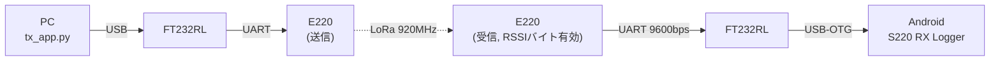

# S220 RX Logger（Android）

LoRa 通信モジュール **E220-900T22L** の電波到達性を屋外で評価するための Android アプリです。
スマートフォンに USB-OTG で **FT232RL + E220** を接続し、受信したデータを **RSSI・GPS 位置と一緒に記録**します。

- 受信データ・RSSI・位置を 1 行ずつ画面表示
- RSSI に応じた**音階ビープ**（画面を見ずに電波の強弱が分かる）
- **CSV ログ**と **GPX（受信地点 + RSSI / 移動軌跡）** を自動保存 → Google マイマップ等でエリアマップ化
- **フォアグラウンドサービス**で動作し、画面 OFF・他アプリ使用中も記録を継続
- `SEQ` の連番抜けから**パケットロスを推定**

送信側は PC の [`tx_app.py`](../tx_app.py)（リポジトリ直下）を想定しています。



## ドキュメント

| ドキュメント | 内容 |
| --- | --- |
| [docs/specification.md](docs/specification.md) | **仕様書**: 画面・操作・受信データ処理・ログファイル形式・音・通知・定数 |
| [docs/design.md](docs/design.md) | **設計書**: アーキテクチャ、クラス責務、スレッドモデル、データフロー、既知の制約 |
| [docs/adr/](docs/adr/README.md) | **ADR（Architecture Decision Record）**: 主要な設計判断とその理由 |
| [../S220HW.md](../S220HW.md) | ハードウェア構成（FT232RL ⇔ E220 結線） |
| [../README.md](../README.md) | PC 側（`tx_app.py` / `rx_app.py`）の使い方 |

## クイックスタート

### 必要なもの

- Android 7.0（API 24）以上、USB ホスト（OTG）対応の端末と OTG ケーブル
- FT232RL + E220-900T22L（[S220HW.md](../S220HW.md) の結線）
- E220 の設定で **RSSI バイト = 有効**（[`sample_code/config_gui.pyw`](../sample_code/config_gui.pyw) 等で事前に書き込む）

### ビルド

Android Studio で `S220/` フォルダを開くか、コマンドラインで以下を実行します（JDK 17 が必要）。

```powershell
cd S220
.\gradlew.bat assembleDebug        # APK 作成 (app/build/outputs/apk/debug/)
.\gradlew.bat installDebug         # 接続中の端末へインストール
.\gradlew.bat testDebugUnitTest    # 受信処理ロジックの単体テスト
```

### 使い方

1. アプリを起動し、位置情報・通知の権限を許可する
2. ログの保存先（端末 / SD カード）を選ぶ → 受信サービスが開始する
3. FT232RL を接続し、USB の使用許可ダイアログで「OK」
4. 送信側 PC で `python tx_app.py COMx --interval 5` などを実行
5. 終了はメニュー（右上 ⋮）→「停止して終了」、または通知の「停止」

ログは `<保存先>/s220_logs/rx_yyyyMMdd_HHmmss.csv`, `..._rssi.gpx`, `..._track.gpx` に保存されます。
PC と USB 接続（MTP）して取り出せます（パスはメニュー →「保存先を表示」で確認）。

## ソース構成

```
app/src/main/java/com/example/s220/
├── MainActivity.kt          画面（権限・保存先選択・メニュー・ログ一覧）
├── LogAdapter.kt            ログ一覧の RecyclerView.Adapter
├── RxHub.kt                 Service → 画面 の橋渡し（直近 2000 行と状態を保持）
├── RxService.kt             フォアグラウンドサービス（USB・処理・記録・通知の統括）
├── usb/SerialReceiver.kt    [I/O層] USB シリアル受信スレッド
├── core/RxCore.kt           [処理層] パケット化・RSSI 分離・行分割・解析・統計（Android 非依存）
├── core/RssiScale.kt        RSSI → 音階の対応
├── location/LocationTracker.kt  GPS / ネットワーク位置の取得
├── log/TextLogWriter.kt     CSV ログ出力
├── log/GpxWriter.kt         GPX 出力（受信地点 / 軌跡）
├── audio/RssiTonePlayer.kt  音階ビープ再生
└── model/LogEntry.kt        ログ 1 行・位置スナップショット・整形ユーティリティ
app/src/test/.../core/RxCoreTest.kt   処理層の JVM 単体テスト
```
