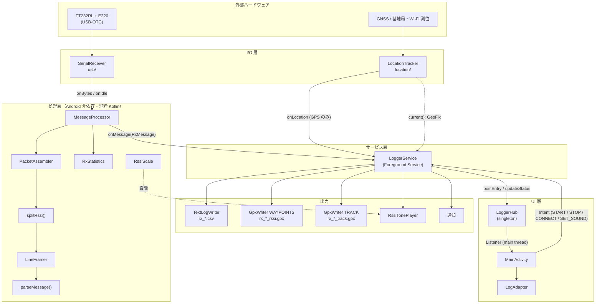
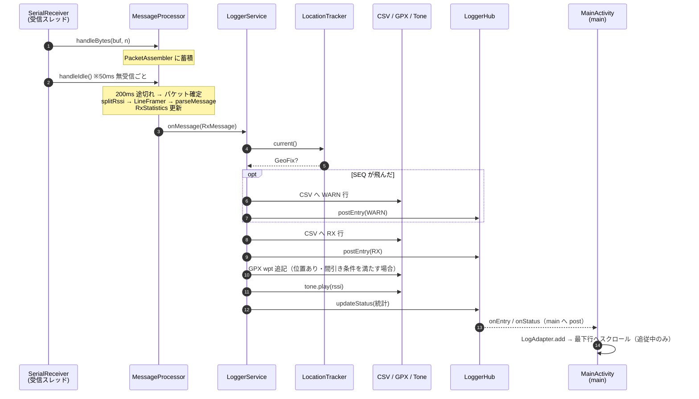
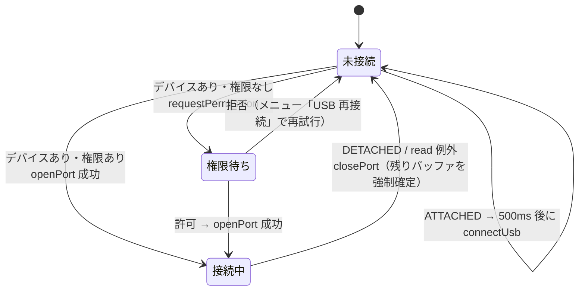

# S220 RX Logger 設計書

対象: `S220/`（Android アプリ, `com.example.s220`, versionName 1.0）
関連: [仕様書](specification.md) / [ADR 一覧](adr/README.md)

---

## 1. 目的と位置づけ

PC 用の受信スクリプト [`rx_app.py`](../../rx_app.py) を Android へ移植し、**持ち歩いて電波到達範囲を測る**ためのロガーにしたものです。
PC 版の要件（[S220SW.md](../../S220SW.md)）で「UI と UART 通信のコアロジックを分離し、Android へ移植できるようにする」と定めていたため、
`rx_app.py` の 3 層構造（I/O 層・処理層・UI 層）をそのまま引き継ぎ、Android 固有の要素（USB ホスト、フォアグラウンドサービス、GPS、ファイル出力、音）を周辺に追加しています。

アプリは**受信専用**です。モジュールの設定変更や送信は行いません（[ADR-0001](adr/0001-receive-only-logger.md)）。

## 2. 全体構成



### 層の依存ルール

| 層 | 依存してよいもの | 依存してはならないもの |
| --- | --- | --- |
| 処理層 `core/` | Kotlin 標準ライブラリのみ | Android SDK、USB ライブラリ、UI |
| I/O 層 `usb/`, `location/` | Android SDK / usb-serial-for-android | 処理層の内部、UI |
| サービス層 `LoggerService` | 全層（組み立て役） | `MainActivity` を直接参照しない（`LoggerHub` 経由） |
| UI 層 | `LoggerHub`, `model/`, `RssiScale` | `LoggerService` の内部状態（Intent でのみ操作） |

処理層を純粋 Kotlin に保つことで、`src/test` の JVM 単体テストで端末なしに検証できます（[ADR-0003](adr/0003-port-layered-core-from-python.md)）。

## 3. パッケージとクラスの責務

| パッケージ / クラス | 責務 | Python 版の対応 |
| --- | --- | --- |
| `MainActivity` | 権限要求、保存先選択ダイアログ、メニュー、ログ一覧表示、最新行の自動追従 | `ConsolePresenter`（表示部分） |
| `LogAdapter` | 1 行 = 時刻 / Body / RSSI(+音名) / 位置 の描画、種別ごとの色分け、縞模様 | `ConsolePresenter.show_message` |
| `LoggerHub` | Service と画面の橋渡し。直近 2000 行と `Status` を保持し、メインスレッドでリスナーへ通知 | （なし：Android 追加） |
| `LoggerService` | セッション管理、USB 接続/再接続、受信結果の配信（CSV・GPX・音・画面・通知）、WakeLock | `main()` |
| `usb/SerialReceiver` | 専用スレッドで `UsbSerialPort.read()` をループし `onBytes` / `onIdle` / `onError` を通知 | `SerialReceiver` |
| `core/MessageProcessor` | バイト列 → `RxMessage` 変換の統括。RSSI モード時はパケット化してから行分割 | `MessageProcessor` |
| `core/PacketAssembler` | UART 出力が `gapMs` 途切れたら 1 無線パケットとして確定 | `PacketAssembler` |
| `core/splitRssi()` | パケット末尾の RSSI バイトを分離（改行位置によるヒューリスティック） | `split_rssi()`（※判定ロジックは Android 版で拡張） |
| `core/LineFramer` | `\n` 区切りでフレーム化、`\r` 除去、アイドル/サイズ上限での強制確定 | `LineFramer` |
| `core/parseMessage()` | `KEY=VALUE,...,MSG=本文` を Map に変換 | `parse_message()` |
| `core/RxStatistics` | 受信件数・バイト数・SEQ 欠落数・RSSI 最小/平均/最大/最新 | `RxStatistics` |
| `core/RssiScale` | RSSI → 15 段階の音階（ド4〜ド6）と音名 | （なし） |
| `location/LocationTracker` | GPS(1 秒) + ネットワーク(5 秒) の位置取得、最良位置の選択 | （なし） |
| `log/TextLogWriter` | CSV（UTF-8 BOM 付き、1 行ごと flush） | （なし） |
| `log/GpxWriter` | GPX 1.1 の逐次書き出し（常に整形式を保つ）、5 m / 10 秒の間引き | （なし） |
| `audio/RssiTonePlayer` | 正弦波ビープを専用スレッドで再生、最新 1 件のみ保持 | （なし） |
| `model/LogEntry`, `GeoFix`, `Fmt` | ログ 1 行・位置スナップショット・制御文字の可視化と座標整形 | `RxMessage`（一部） |

## 4. スレッドモデル

| スレッド | 生成元 | 実行される処理 |
| --- | --- | --- |
| **main** | Android | Activity のライフサイクル・描画、`LoggerHub` の状態更新とリスナー通知、Service の `onStartCommand`、USB ブロードキャスト受信、1 秒ティック（GPS 状態更新）、通知更新、`closePort()` |
| **SerialReceiver** (`MAX_PRIORITY`, daemon) | `SerialReceiver.start()` | `port.read(buf, 50ms)` → `MessageProcessor.handleBytes/handleIdle` → `LoggerService.onRxMessage` → CSV / GPX 書き込み、音の要求、`LoggerHub.post*` |
| **LocationTracker** (`HandlerThread`) | `LocationTracker.start()` | 位置更新コールバック → 軌跡 GPX 追記 |
| **RssiTonePlayer** (daemon) | `RssiTonePlayer` 生成時 | キューから RSSI を取り出して `AudioTrack` で再生（約 180 ms ブロック） |

スレッド間の取り決め:

- **画面に関わる状態は必ずメインスレッドで変更する**。`LoggerHub.postEntry / updateStatus / clear` は呼び出しスレッドに関係なく `Handler(mainLooper)` へ post します。
- `MessageProcessor` は内部バッファを `synchronized(lock)` で保護します。`handleBytes/handleIdle` は通常 SerialReceiver スレッドから、切断時の `handleIdle(force = true)` はメインスレッドから呼ばれるためです。`onMessage` は**ロックの外**で呼びます。
- `TextLogWriter.write` / `GpxWriter.add*` は `@Synchronized`。受信スレッド・メインスレッド（システムメッセージ）・位置スレッドから同時に呼ばれ得るためです。
- `RssiTonePlayer` は容量 1 のキューで、再生中に来た要求は**最新 1 件で上書き**します。受信が速くても音が溜まって遅れません。
- `SerialReceiver.stop()` は受信スレッドを最大 1 秒 `join` してからポートを閉じます（呼び出し側の `closePort()` が担当）。

## 5. データフロー

### 5.1 受信 1 件の処理



### 5.2 処理層のパイプライン

```
RSSI モード（アプリでは常に有効）:
  bytes ─▶ PacketAssembler ──(200ms 無出力)──▶ packet ─▶ splitRssi ─▶ payload ─▶ LineFramer ─▶ frames
                                                               └─▶ rssi(分離できなければ null) ─▶ lastRssi / RxStatistics.updateRssi
  frame ─▶ parseMessage ─▶ SEQ ─▶ RxStatistics.update（欠落推定） ─▶ RxMessage(rssiDbm = lastRssi)

非 RSSI モード（MessageProcessor は対応しているがアプリでは未使用）:
  bytes ─▶ LineFramer ─▶ frames ─▶ parseMessage ─▶ ...
```

改行が来ないまま 500 ms 経過したデータは `terminated = false` のフレームとして確定し、画面には `(timeout)`、CSV には `RX(timeout)` と出ます。

## 6. ライフサイクルと状態

### 6.1 Activity

| コールバック | 処理 |
| --- | --- |
| `onCreate` | View 構築 → 権限要求（位置、Android 13+ は通知）→ 結果に関わらず `checkAndStartLogging()` |
| `checkAndStartLogging` | `LoggerHub.status.running` なら何もしない。停止中なら保存先選択ダイアログ → `LoggerService.start(logDir, soundOn = true)`。停止中はメニュー「記録を開始」からも呼ばれる |
| `onStart` | `LoggerHub.addListener` → `LoggerHub.snapshot()` で一覧を復元 |
| `onStop` | `LoggerHub.removeListener` |

`launchMode="singleTop"`。FT232RL 接続（`USB_DEVICE_ATTACHED`）でアプリが起動/前面化します。
Activity が破棄されても受信はサービスで継続し、再表示時に `LoggerHub` の直近 2000 行から画面を復元します。

### 6.2 LoggerService の Intent

| Action | 送信元 | 処理 |
| --- | --- | --- |
| `ACTION_START` (+ `log_dir`, `sound`) | 保存先選択後 | `startForeground` → 未開始ならセッション開始、開始済みなら USB 接続を試行 |
| `ACTION_CONNECT` | メニュー「USB 再接続」 | セッション中なら `connectUsb()` |
| `ACTION_SET_SOUND` (+ `sound`) | メニュー「音を鳴らす」 | 音の ON/OFF を切り替え `Status.soundOn` に反映 |
| `ACTION_STOP` | メニュー「停止して終了」、通知の「停止」 | セッション終了 → `stopSelf()` |
| `null`（システム再起動等） | — | セッションが無ければ `stopSelf()` |

戻り値は `START_NOT_STICKY` です（プロセスが殺されても自動再開しない）。

### 6.3 セッション

`startSession(dir)` で以下を順に行います。`stopSession()` は逆順に解放します。

1. `s220_logs` ディレクトリ作成、`rx_<yyyyMMdd_HHmmss>` で CSV / RSSI GPX / 軌跡 GPX を作成
2. `MessageProcessor(rssiEnabled = true)` と `RssiTonePlayer` を生成
3. `LoggerHub` をクリアし `Status(running = true, logDir, soundOn)` を設定、SYS 行「ログ開始」
4. 位置権限があれば `LocationTracker.start()`（失敗・GPS OFF は WARN 行）
5. `PARTIAL_WAKE_LOCK` を取得（タイムアウト 24 時間。1 秒ティックで 1 時間ごとに取り直して延長）
6. USB ブロードキャスト受信登録、1 秒ティック開始、`connectUsb()`

### 6.4 USB 接続状態



- `connectUsb()` はセッション中・未接続・権限待ちでない場合のみ動作します（多重接続しない）。
- ドライバは `UsbSerialProber.getDefaultProber()` で検索し、**FTDI を優先**、なければ最初に見つかったものを使います。
- 切断時は `SerialReceiver.stop()` → `port.close()` → `processor.handleIdle(force = true)` の順に処理し、途中まで受信していたデータも失わずに記録します。

## 7. エラー処理方針

「**記録は止めない、問題は画面とログに残す**」を基本にしています。

| 事象 | 対応 |
| --- | --- |
| ログファイル作成失敗 | WARN 行を出し、ファイルなしで受信・表示は続行 |
| GPX 書き込み失敗（SD 抜け等） | 例外を握りつぶして続行（`GpxWriter.append`） |
| 位置権限なし / GPS OFF | WARN 行を出し、位置なしで記録 |
| USB 権限拒否・オープン失敗 | WARN 行 + USB ステータス表示。メニューから再接続可能 |
| 受信中の USB 抜け・read 例外 | `onError` → メインスレッドで `closePort`、WARN 行。再接続で自動復帰 |
| 通知の `SecurityException`（通知権限なし） | 無視 |
| 音の再生失敗 | ログ出力のみで続行 |

受信データ中の制御文字は `Fmt.sanitize` で `\xNN` 表記に変換し、画面・CSV・GPX の表示が崩れないようにしています。

## 8. 永続化の設計

| 出力 | 書き込み方式 | 中断耐性 |
| --- | --- | --- |
| CSV | `BufferedWriter`、**1 行ごとに flush**、UTF-8 BOM、CRLF | 強制終了でも直前の行まで残る |
| GPX | `RandomAccessFile` で**閉じタグの直前に追記し、閉じタグを毎回書き直す** | 途中で落ちても常に整形式の GPX として読める |

アプリ内の設定値（音 ON/OFF、保存先）は永続化しません。起動ごとに保存先を選び、音は ON で開始します。

## 9. Python 版 `rx_app.py` との差分

| 項目 | `rx_app.py` | Android 版 |
| --- | --- | --- |
| I/O | pyserial、`read_timeout` 0.1 s | usb-serial-for-android、`read` タイムアウト 50 ms |
| RSSI モード | `--rssi` で選択（既定 OFF） | **常に ON** |
| パケット境界 | 80 ms 無出力 | **200 ms** 無出力（`operation_code_win/receive.py` の `PACKET_GAP_SEC` に合わせた） |
| RSSI 分離 | 常に末尾 1 byte | 改行位置と値域で判定（[ADR-0007](adr/0007-rssi-split-heuristic.md)） |
| 表示 | コンソール | RecyclerView + ステータス行 + 通知 |
| 追加機能 | — | GPS、CSV/GPX 保存、音階ビープ、バックグラウンド動作 |

## 10. テスト

`app/src/test/java/com/example/s220/core/RxCoreTest.kt`（JVM 単体テスト, JUnit 4）で処理層を検証しています。
`Clock` を差し替えられるため、時間依存の処理も実時間を待たずにテストできます。

| テスト | 検証内容 |
| --- | --- |
| `testLineFramer` | LF / CRLF での分割、未終端データのアイドルタイムアウト確定 |
| `testSplitRssi` | 末尾 RSSI の分離、改行終端のみ（RSSI なし）の誤検出防止、LF / CRLF + RSSI |
| `testParseMessage` | `SEQ` / `TS` / `MSG`（本文中の `,` を含む）の解析 |
| `testRxStatistics` | SEQ 抜けからの欠落数、RSSI の最小/最大/平均 |
| `testMessageProcessorRssiMode` | 分割到着したデータの 200 ms 無出力でのパケット確定、RSSI の付与、RSSI なしパケットに前回値を引き継がないこと |
| `testRssiScale` | 音階の下限・上限、周波数の単調性 |

実行: `S220/` で `.\gradlew.bat testDebugUnitTest`（JDK 17。Android Studio 同梱の `jbr` で可）。
Android 依存部分（Service・USB・GPS・GPX/CSV 出力・音）は自動テストがありません。

## 11. 既知の制約と改善候補

コードから読み取れる現状の制約です。評価時の解釈や今後の改修の参考にしてください。

| # | 制約 | 影響 | 改善案 |
| --- | --- | --- | --- |
| 1 | RSSI モードが常に ON（設定 UI なし） | E220 の RSSI バイトが無効だと、改行で終わらないデータの末尾 1 byte（値 0x6A〜0xFF。ASCII の `j`〜`~` や UTF-8 の後続バイトを含む）が RSSI と誤認されて削られる | RSSI モードの切り替えをメニューに追加 |
| 2 | パケット境界は 200 ms の無出力で判定 | 送信間隔が短く 2 パケットが 200 ms 以内に連続すると 1 パケットとして扱われ、前のパケットの RSSI バイトが次の行の先頭にゴミとして残る。RSSI も後ろのパケットの値のみ集計される | 送信間隔を十分空ける運用とする / AUX 監視やヘッダ付きプロトコルの検討 |
| 3 | 行の RSSI は「その行を完成させたパケットの RSSI」 | 1 行が複数の無線パケット（既定サブパケット長 200 byte 超）にまたがる場合は最後のパケットの値 | パケットごとに RSSI を行へ紐付ける |
| 4 | RSSI GPX は 5 m 未満かつ 10 秒未満の受信を間引く | 静止状態で短周期送信すると GPX の点は 10 秒に 1 点（CSV には全件残る） | 間引き条件を設定可能にする |
| 5 | 軌跡 GPX は GPS プロバイダの位置のみ | 屋内などネットワーク位置しか得られない区間は軌跡に残らない（受信地点 GPX・CSV にはネットワーク位置も残る） | — |
| 6 | `START_NOT_STICKY` | OS にプロセスを終了された場合、自動では再開しない | 状態を保存して `START_STICKY` 化 |
| 7 | ボーレート 9600 bps 固定 | E220 の UART 速度を変えたモジュールでは文字化け | 設定項目化 |
| 8 | 自動起動の `device_filter` は FTDI (VID 0x0403) のみ | 他チップ（CH340 等）もドライバ上は使えるが、接続時の自動起動はしない | フィルタ追加 |
| 9 | `targetSdk 33` | `targetSdk 34` 以上に上げる場合、位置権限がないときに `startForeground` を type 0 で呼ぶ処理と FGS タイプ宣言の見直しが必要 | `connectedDevice` タイプ併用の検討 |
| 10 | 「画面をクリア」は画面上の一覧のみ消去 | 統計（RX 件数・欠落・RSSI）とファイルはリセットされない | 仕様として明記済み |
| 11 | 1024 byte 上限で強制確定した行も `terminated = true` 扱い | 改行なしで 1024 byte 溜まった行に `(timeout)` が付かない | `LineFramer.feed` で終端種別を返す |
| 12 | PC 版 `rx_app.py` とパケット境界（80 ms / 200 ms）・RSSI 分離ロジックが異なる | PC と Android で同じ受信データの解釈が変わり得る | PC 版を Android 版にそろえる |
| 13 | CSV の `local_time` にタイムゾーンがない（GPX は UTC） | 端末のタイムゾーンを変えると突き合わせに注意が必要 | オフセット付きにする（CSV 形式の変更になる） |

### 11.1 対応済み（2026-10-16）

| 内容 | 対応 |
| --- | --- |
| RSSI バイトを分離できなかったパケットの行に、前回パケットの RSSI が付いていた | パケットごとに `lastRssi` を更新（分離できなければ `null`）。`RxCoreTest.testMessageProcessorRssiMode` を追加 |
| WakeLock が 24 時間で切れ、それ以降は CPU スリープで取りこぼす可能性があった | 1 秒ティック内で 1 時間ごとに `acquire` し直してタイムアウトを延長 |
| 通知の「停止」で止めた後、画面から記録を再開できなかった | 停止中だけメニューに「記録を開始」を表示 |
| 「SDカード（未挿入）」を選ぶと黙って端末内部に保存していた | 選んだ場合はトーストで知らせ、保存先ダイアログを出し直す |
| 受信スレッドから参照する `location` / `tone` が `@Volatile` でなかった | `@Volatile` を付与 |
| `RssiScale` の KDoc で最低音の境界が実装（−111 dBm 以下）と食い違っていた | KDoc を修正 |
| `splitRssi` の「末尾から 2〜3 番目が改行」判定が値域を見ず、改行の後の 0x00 を −256 dBm と表示していた | 改行終端以外は値域判定（−150〜0 dBm）に一本化。`RxCoreTest.testSplitRssi` にケースを追加 |
