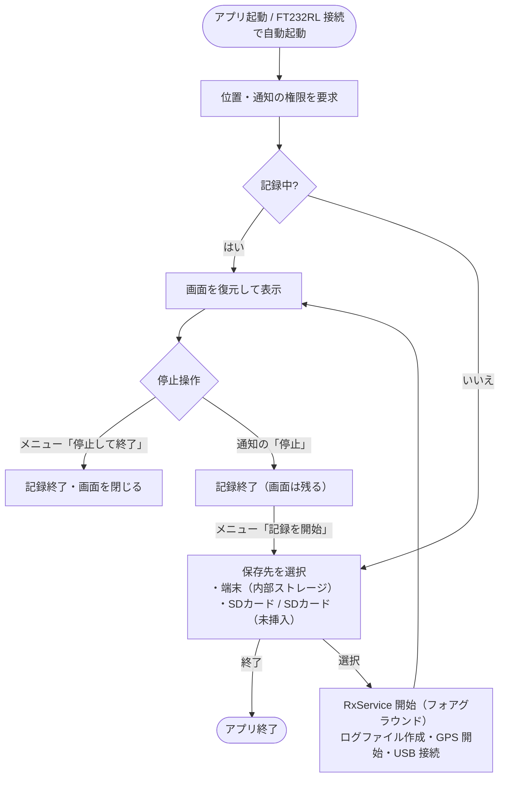

# S220 RX Logger 仕様書

対象: `S220/`（Android アプリ, applicationId `com.example.s220`, versionName 1.0）
関連: [設計書](design.md) / [ADR 一覧](adr/README.md) / [ハードウェア構成](../../S220HW.md)

---

## 1. 概要

### 1.1 目的

E220-900T22L（LoRa, 920 MHz 帯）の**受信側を持ち歩き**、受信できた場所・受信強度（RSSI）・パケットロスを記録して、通信可能エリアを評価する。

### 1.2 スコープ

| 対象 | 対象外 |
| --- | --- |
| USB-OTG 経由の FT232RL からの受信 | 送信 |
| RSSI バイトの分離・集計・音での通知 | E220 のレジスタ設定（アドレス・チャンネル・空中レート等） |
| 受信 1 件ごとの GPS 位置の付与 | 地図表示（GPX を外部ツールで閲覧する） |
| CSV / GPX ファイルへの記録 | クラウド送信・共有 |
| `SEQ` 連番からのパケットロス推定 | 送信側との時刻同期・遅延計測 |

## 2. 動作環境・前提条件

| 項目 | 条件 |
| --- | --- |
| OS | Android 7.0（API 24）以上。ビルド設定は `compileSdk 33` / `targetSdk 33` |
| 端末 | USB ホスト（OTG）対応。GNSS 搭載を推奨 |
| USB シリアル変換 | FT232RL（VID `0x0403` / PID `0x6001`）。usb-serial-for-android が対応する他チップも動作可（自動起動は FTDI のみ） |
| UART | **9600 bps, 8N1 固定** |
| E220 動作モード | ノーマルモード（M0 = M1 = GND）。結線は [S220HW.md](../../S220HW.md) |
| E220 設定 | **RSSI バイト = 有効**（必須）。送信側とアドレス・チャンネル・空中データレートが一致していること |
| 送信側 | 1 メッセージ = 改行（`\n` または `\r\n`）終端のテキストを推奨。[`tx_app.py`](../../tx_app.py) の形式 `SEQ=000001,TS=...,MSG=...` で欠落推定が有効になる |

> [!IMPORTANT]
> 本アプリは RSSI バイトが付加されている前提で動作します（設定で切り替え不可）。
> RSSI バイトが無効なモジュールでも改行終端のテキストは正しく受信できますが、改行で終わらないデータは末尾 1 byte を RSSI と誤認することがあります（[設計書 §11](design.md#11-既知の制約と改善候補)）。

## 3. 権限

| 権限 | 用途 | 要求タイミング |
| --- | --- | --- |
| `ACCESS_FINE_LOCATION` / `ACCESS_COARSE_LOCATION` | 受信地点・軌跡の記録 | 起動時（実行時許可） |
| `POST_NOTIFICATIONS` | 記録中通知（Android 13 以上） | 起動時（実行時許可） |
| `FOREGROUND_SERVICE` / `FOREGROUND_SERVICE_LOCATION` | バックグラウンド受信 | インストール時 |
| `WAKE_LOCK` | 画面 OFF 中の CPU スリープ防止 | インストール時 |
| USB デバイス使用許可 | FT232RL へのアクセス | 接続時に OS のダイアログで確認 |

位置・通知の権限を拒否しても記録は開始します（位置なし・通知なしで動作）。

## 4. 画面仕様

画面は 1 つ（`MainActivity`）。ダークテーマ固定のカラーパレットを使用します。

```
┌──────────────────────────────────────────┐
│ S220 RX Logger                         ⋮ │ ← タイトル / メニュー
│ USB: FT232R USB UART 9600bps   GPS: ±5m 1s前 │ ← 接続状態
│ RX: 128   欠落: 2   RSSI: -78 (均-81)  GPX: 40点 │ ← 統計
├──────┬────────────────────┬──────┬────────┤
│ TIME │ BODY               │ RSSI │LOCATION│ ← 列ヘッダー
├──────┼────────────────────┼──────┼────────┤
│12:34:│SEQ=000127,TS=...   │-78dBm│35.6812…│
│56.789│                    │ ド5  │139.767…│
│ ...  │[WARN] 欠落の可能性…│ ---  │  ...   │
└──────┴────────────────────┴──────┴────────┘
                 [ ↓ 最新へ ]                ← 上へスクロールしたときだけ表示
```

### 4.1 ステータス行

**USB 状態**（接続中は緑、それ以外は橙）

| 表示 | 状態 |
| --- | --- |
| `USB: <製品名> 9600bps` | 接続中 |
| `USB: 未接続（FT232RL を接続してください）` | 対応デバイスが見つからない |
| `USB: 使用許可を待っています…` | OS の許可ダイアログ表示中 |
| `USB: 権限なし（メニュー→USB再接続）` | 許可が拒否された |
| `USB: オープン失敗` | デバイスを開けない |
| `USB: 未接続` | 切断後 |
| `USB: 停止` | 記録停止後 |

**GPS 状態**（1 秒ごとに更新。位置が 10 秒以内なら緑）

| 表示 | 状態 |
| --- | --- |
| `GPS: ±<精度>m <経過>s前` | GPS 由来の位置 |
| `NET: ±<精度>m <経過>s前` | ネットワーク由来の位置 |
| `GPS: 測位中…` | まだ位置が得られていない |
| `GPS: 権限なし` | 位置権限なし |

**統計行**

| 項目 | 内容 |
| --- | --- |
| `RX: n` | 受信フレーム数（RX 行の数） |
| `欠落: n` | SEQ 連番抜けから推定した欠落件数の累計 |
| `RSSI: <最新> (均<平均>)` | 最新 RSSI と平均（dBm, 平均は整数に丸め）。未受信時 `RSSI: ---` |
| `GPX: n点` | 受信地点 GPX に書き込んだ点数（間引き後） |

### 4.2 ログ一覧

| 列 | 表示内容 |
| --- | --- |
| TIME | 端末ローカル時刻 `HH:mm:ss.SSS`（受信確定時刻） |
| BODY | 受信テキスト（制御文字は `\xNN` 表記）。種別により表示が変わる（下表） |
| RSSI | `<値>dBm` と音名（例 `ド5`）。RSSI なしは `---` |
| LOCATION | 緯度・経度（小数 6 桁, 2 行）。位置が 10 秒より古い場合は薄く表示。位置なしは `---` |

| 種別 | BODY の表示 | 文字色 |
| --- | --- | --- |
| RX（改行で確定） | 受信テキスト | 白 |
| RX（タイムアウトで確定） | 受信テキスト + ` (timeout)` | 白 |
| WARN | `[WARN] <メッセージ>` | 橙 |
| SYSTEM | `[SYS] <メッセージ>` | 水色 |

- 行は下から積み上げ、偶数/奇数行で背景色を変える（縞模様）。
- 画面に保持するのは**直近 2000 行**。超えた分は古い順に消える（ファイルには全件残る）。
- **自動追従**: 最下行にいる間は新しい行が来るたびに最下行へスクロールする。上へスクロールすると追従を止め「最新へ」ボタンを表示し、押すか最下行まで戻ると追従を再開する。
- 行が 0 件のときは「受信待機中… FT232RL + E220 を USB 接続してください」を表示する。

### 4.3 メニュー（右上 ⋮）

| 項目 | 動作 |
| --- | --- |
| 記録を開始 | **停止中のみ表示**。保存先を選んで記録を始める（通知の「停止」で止めた後の再開用） |
| 音を鳴らす（チェック） | RSSI ビープの ON/OFF。記録開始時は ON |
| 画面を常にON（チェック） | 表示中の画面を消灯させない（`FLAG_KEEP_SCREEN_ON`） |
| USB 再接続 | USB の検索・接続をやり直す（権限拒否後の再要求にも使う） |
| 保存先を表示 | ログ保存フォルダのフルパスを表示 |
| 画面をクリア | 画面の一覧のみ消去。統計とファイルはそのまま |
| 停止して終了 | 記録を終了し、サービスと画面を閉じる |

### 4.4 システムメッセージ一覧

画面と CSV に記録されるメッセージです。

| 種別 | メッセージ | 発生条件 |
| --- | --- | --- |
| SYS | `ログ開始: <dir>/rx_<日時>.*` | 記録開始 |
| SYS | `USB 接続: <製品名> (9600bps 8N1)` | ポートを開いた |
| SYS | `ログ終了` | 記録停止 |
| WARN | `欠落の可能性: n 件 (SEQ が飛びました)` | SEQ の連番抜けを検出（該当 RX 行の直前に出る） |
| WARN | `USB 切断` / `USB 切断/エラー: <理由>` | デバイス取り外し / 読み込み例外 |
| WARN | `USB の使用が許可されませんでした` | 許可ダイアログで拒否 |
| WARN | `USB デバイスを開けません` / `USB オープン失敗: <理由>` | オープン失敗 |
| WARN | `ログファイルを作成できません: <理由>` | ファイル作成失敗 |
| WARN | `位置情報の権限がありません（位置なしで記録します）` | 位置権限なし |
| WARN | `位置情報を開始できません` / `端末の位置情報(GPS)がOFFです` | 位置プロバイダ利用不可 / GPS OFF |

## 5. 起動・終了



- 保存先ダイアログはキャンセル不可（選ぶか「終了」）。
- 保存先の実体はアプリ固有外部ストレージ `Android/data/com.example.s220/files/s220_logs/`（端末または SD カード側）。
- SD カードが挿入されていない場合「SDカード（未挿入）」が表示される。選ぶと「SDカードが見つかりません」と表示し、保存先ダイアログを出し直す。
- 画面を閉じても（ホームボタン・画面 OFF・他アプリ使用中）記録は継続する。
- 記録中に再度アプリを開くと保存先は聞かれず、記録中の状態をそのまま表示する。

## 6. USB 接続

| 項目 | 仕様 |
| --- | --- |
| デバイス検索 | 接続済み USB デバイスから usb-serial-for-android の既定プローバで検索。FTDI を優先し、なければ最初のデバイス |
| ポート | デバイスの第 1 ポート |
| 通信設定 | 9600 bps, データ 8 bit, ストップ 1 bit, パリティなし |
| オープン直後 | 受信ハードウェアバッファを破棄（古いデータを読まない） |
| 自動接続 | 記録開始時、および `USB_DEVICE_ATTACHED` 受信の 500 ms 後 |
| 切断検知 | `USB_DEVICE_DETACHED`（接続中のデバイス ID と一致）または読み込み例外 |
| 切断時 | 受信途中のデータを強制確定して記録し、WARN 行を出す。再接続で自動復帰 |
| 自動起動 | `device_filter.xml` に一致する FTDI デバイス（VID 1027 = 0x0403）の接続でアプリを起動 |

## 7. 受信データ処理

### 7.1 処理の流れ

1. **読み込み**: 50 ms タイムアウトで USB から読み込む。データがあれば処理層へ渡し、なければアイドル処理を呼ぶ。
2. **パケット化**: UART 出力が **200 ms** 途切れたところまでを 1 無線パケットとする。
3. **RSSI 分離**: パケット末尾から RSSI バイトを取り出す（§7.2）。
4. **行分割**: `\n` で区切ってフレームにする（§7.3）。
5. **解析**: `KEY=VALUE` 形式なら項目を取り出す（§7.4）。
6. **集計**: 受信数・欠落・RSSI を更新する（§7.5）。

### 7.2 RSSI バイトの分離

E220 は RSSI バイト有効時、受信データの後ろに 1 byte を出力します。**RSSI [dBm] = バイト値 − 256**。
パケット末尾を次の順で判定します。

| 順 | 条件 | 結果 |
| --- | --- | --- |
| 1 | 末尾が `\n` (0x0A) または `\r` (0x0D) | RSSI なし。パケット全体がペイロード |
| 2 | 末尾から 2 番目が `\n` / `\r` | 末尾 1 byte を RSSI とする |
| 3 | 末尾から 3 番目が `\n` / `\r` | 末尾 1 byte を RSSI とする |
| 4 | 末尾バイト − 256 が −150〜0 dBm（バイト値 106〜255） | 末尾 1 byte を RSSI とする |
| 5 | いずれにも該当しない | RSSI なし |

各行に付く RSSI は「その行の改行を含むパケット（行を完成させたパケット）の RSSI」です。1 行が複数パケットにまたがる場合は最後のパケットの値になります。RSSI を分離できなかったパケットで完成した行は RSSI なし（`---`）になります。

### 7.3 行分割（フレーミング）

| 規則 | 値 |
| --- | --- |
| 区切り | `\n`。直前の `\r` は除去する |
| アイドル確定 | 改行がないまま **500 ms** 新しいデータがなければ確定（`terminated = false`、画面に `(timeout)`） |
| サイズ上限 | 改行なしで **1024 byte** 溜まったら強制確定 |
| 空行 | 記録しない |
| 文字コード | UTF-8 としてデコード（不正なバイトは置換文字） |

### 7.4 メッセージ解析

`tx_app.py` の送信形式を解析します。

```
SEQ=000001,TS=2026-10-15T00:11:00.123,MSG=hello, world
```

- `,` 区切りの `KEY=VALUE`。`MSG=` 以降は最後の項目として `,` を含めてそのまま取り出す。
- `=` を含まない、またはキーが空の項目があれば形式外とみなし、項目なし（テキストのみ）で扱う。
- `SEQ` を整数として解釈できればパケットロス推定に使う。`TS` は解析するが記録には使わない（BODY に含まれる）。

### 7.5 統計とパケットロス推定

| 項目 | 規則 |
| --- | --- |
| 受信数 | 確定したフレーム数（空行を除く） |
| 欠落 | 新しい SEQ が前回 SEQ + 1 より大きければ、その差 − 1 を欠落として加算 |
| SEQ の巻き戻り | 新しい SEQ ≦ 前回 SEQ の場合は送信側の再起動とみなし、欠落とせず基準を更新 |
| SEQ なし | 欠落推定の対象外（基準は変えない） |
| RSSI | 分離できたパケットごとに最新・最小・最大・平均を更新（画面には最新と平均を表示） |

統計は記録開始時にリセットされます。「画面をクリア」ではリセットされません。

## 8. 位置情報

| 項目 | 仕様 |
| --- | --- |
| 取得方式 | Android 標準 `LocationManager`（Google Play 開発者サービス不要） |
| GPS | 1 秒間隔で要求 |
| ネットワーク位置 | 5 秒間隔で要求（屋内などの補完用） |
| 位置の選択 | GPS が 10 秒以内なら GPS。そうでなければ GPS / ネットワークのうち新しい方 |
| 受信行への付与 | 受信確定時点の位置をスナップショット（取得からの経過秒を含む） |
| 「古い」位置 | 経過 10 秒超。画面で薄く表示、GPS ステータスが緑にならない |

## 9. ログファイル

### 9.1 ファイル構成

記録開始ごとに、保存先 `s220_logs/` に 3 ファイルを作成します（`<stamp>` = 開始時刻 `yyyyMMdd_HHmmss`）。

| ファイル | 内容 |
| --- | --- |
| `rx_<stamp>.csv` | 画面に出た全行（RX / WARN / SYS） |
| `rx_<stamp>_rssi.gpx` | 位置付きの受信地点（ウェイポイント） |
| `rx_<stamp>_track.gpx` | GPS による移動軌跡（トラック） |

### 9.2 CSV

- UTF-8（BOM 付き）、改行 CRLF。Excel で直接開ける。
- 1 行ごとに書き込みを確定するため、アプリが強制終了しても直前の行まで残る。
- `,` `"` 改行を含む値はダブルクォートで囲み、`"` は `""` にする。

| 列 | 内容 | 例 |
| --- | --- | --- |
| `local_time` | 端末ローカル時刻 | `2026-10-15 17:40:28.123` |
| `kind` | `RX` / `RX(timeout)` / `WARN` / `SYS` | `RX` |
| `body` | 本文（制御文字は `\xNN`） | `SEQ=000001,TS=...,MSG=hello` |
| `rssi_dbm` | RSSI [dBm]（なしは空） | `-78` |
| `lat` / `lon` | 緯度・経度（小数 6 桁） | `35.681236` |
| `accuracy_m` | 位置の精度 [m] | `4.0` |
| `fix_age_s` | 位置取得からの経過 [秒] | `0.6` |
| `seq` | SEQ（なしは空） | `1` |

### 9.3 受信地点 GPX（`_rssi.gpx`）

- GPX 1.1。受信 1 件 = `<wpt>` 1 点。位置がない受信は記録しない。
- **間引き**: 前回記録点から 5 m 以上移動、または 10 秒以上経過した場合のみ記録する（最初の 1 点は必ず記録）。
- `<name>` に RSSI を入れるため、Google マイマップ等で読み込むとピンのラベルに RSSI が出る。
- 時刻は UTC（ISO 8601, ミリ秒付き）。
- 独自拡張の名前空間 `xmlns:s220="https://example.com/s220/gpx/1"`。

```xml
<wpt lat="35.681236" lon="139.767125">
  <ele>40.2</ele>
  <time>2026-10-15T08:40:28.123Z</time>
  <name>-78 dBm</name>
  <desc>RSSI=-78dBm SEQ=1 | SEQ=000001,TS=2026-10-15T17:40:28.000,MSG=hello</desc>
  <extensions>
    <s220:rssi>-78</s220:rssi>
    <s220:level>7</s220:level>        <!-- 音階インデックス 0〜14 -->
    <s220:seq>1</s220:seq>
    <s220:body>SEQ=000001,TS=2026-10-15T17:40:28.000,MSG=hello</s220:body>
    <s220:accuracy>4.0</s220:accuracy>
    <s220:fixAge>0.6</s220:fixAge>
  </extensions>
</wpt>
```

RSSI がない場合 `<name>` は `RSSI N/A`、`<s220:rssi>` / `<s220:level>` は出力しません。

### 9.4 軌跡 GPX（`_track.gpx`）

- GPX 1.1 の `<trk><trkseg>` に `<trkpt>`（緯度・経度・高度・UTC 時刻）を追記する。
- GPS プロバイダから位置が届くたびに記録（ネットワーク位置は記録しない）。
- 間引き条件は §9.3 と同じ（5 m 以上移動、または 10 秒以上経過）。
- 受信地点 GPX と重ねると、**移動したが受信できなかった区間**が分かる。

### 9.5 共通

- GPX は 1 点追記するたびに閉じタグを書き直すため、途中で終了しても常に正しい GPX として読める。
- 書き込みに失敗（SD カード抜けなど）しても記録処理は止めない。

## 10. RSSI 音階ビープ

受信した RSSI に応じた高さの音を鳴らし、画面を見なくても電波の強弱が分かるようにします。

| 項目 | 仕様 |
| --- | --- |
| 音 | 正弦波 150 ms、立ち上がり/立ち下がり 8 ms のフェード、44.1 kHz モノラル |
| 音量 | メディア音量（端末の音量キー）に従う |
| 鳴るタイミング | RSSI 付きの RX 行ごと。再生中に次の受信があれば最新の 1 件だけを次に鳴らす |
| 音階 | ハ長調 2 オクターブ（ド4〜ド6）の 15 段階。**5 dB ごとに 1 音上がる** |

| 段階 | RSSI [dBm] | 音名 | 周波数 [Hz] |
| ---: | --- | --- | ---: |
| 0 | −111 以下 | ド4 | 261.6 |
| 1 | −110 〜 −106 | レ4 | 293.7 |
| 2 | −105 〜 −101 | ミ4 | 329.6 |
| 3 | −100 〜 −96 | ファ4 | 349.2 |
| 4 | −95 〜 −91 | ソ4 | 392.0 |
| 5 | −90 〜 −86 | ラ4 | 440.0 |
| 6 | −85 〜 −81 | シ4 | 493.9 |
| 7 | −80 〜 −76 | ド5 | 523.3 |
| 8 | −75 〜 −71 | レ5 | 587.3 |
| 9 | −70 〜 −66 | ミ5 | 659.3 |
| 10 | −65 〜 −61 | ファ5 | 698.5 |
| 11 | −60 〜 −56 | ソ5 | 784.0 |
| 12 | −55 〜 −51 | ラ5 | 880.0 |
| 13 | −50 〜 −46 | シ5 | 987.8 |
| 14 | −45 以上 | ド6 | 1046.5 |

段階 = floor((RSSI + 115) / 5) を 0〜14 に丸めた値。音名は画面の RSSI 列と通知にも表示します。

## 11. 通知

| 項目 | 仕様 |
| --- | --- |
| チャンネル | 「受信ログ記録」（重要度: 低、バッジなし、無音） |
| タイトル | `S220 受信ログ記録中` |
| 本文 | `受信 n 件  最新 <RSSI> dBm (<音名>)` |
| サブテキスト | USB 状態（§4.1） |
| 操作 | タップで画面を開く。「停止」ボタンで記録終了 |
| 更新頻度 | 受信時は最大 2 秒に 1 回。USB 状態変化時は即時 |
| 常駐 | 記録中は消去不可（フォアグラウンドサービス通知） |

## 12. 定数一覧

| 定数 | 値 | 定義箇所 |
| --- | --- | --- |
| UART 速度 | 9600 bps (8N1) | `RxConfig.DEFAULT_BAUDRATE` |
| USB 読み込みタイムアウト | 50 ms | `SerialReceiver.readTimeoutMs` |
| パケット境界の無出力時間 | 200 ms | `RxConfig.DEFAULT_PACKET_GAP_MS` |
| 改行なしフレームの確定時間 | 500 ms | `RxConfig.DEFAULT_IDLE_FLUSH_MS` |
| フレーム最大長 | 1024 byte | `RxConfig.MAX_FRAME_BYTES` |
| RSSI として扱う値域 | −150〜0 dBm | `splitRssi()` |
| 画面保持行数 | 2000 行 | `RxHub.MAX_ENTRIES` |
| GPS / ネットワーク要求間隔 | 1 s / 5 s | `LocationTracker` |
| GPS 優先の鮮度 / 古い位置 | 10 s / 10 s | `LocationTracker.GPS_PREFERRED_SEC` / `GeoFix.STALE_SEC` |
| GPX 間引き | 5 m または 10 s | `GpxWriter.MIN_DISTANCE_M` / `MIN_INTERVAL_MS` |
| 音階 | −115 dBm 基準, 5 dB/段, 15 段 | `RssiScale` |
| ビープ長 | 150 ms | `RssiTonePlayer.TONE_MS` |
| ステータス更新周期 | 1 s | `RxService.TICK_MS` |
| 通知更新の最小間隔 | 2 s | `RxService.maybeUpdateNotification` |
| WakeLock タイムアウト / 延長間隔 | 24 時間 / 1 時間 | `RxService.WAKE_LOCK_TIMEOUT_MS` / `WAKE_LOCK_RENEW_MS` |

## 13. 非機能要件

| 項目 | 仕様 |
| --- | --- |
| バックグラウンド動作 | フォアグラウンドサービス（type = location）+ `PARTIAL_WAKE_LOCK` で、画面 OFF・他アプリ使用中も受信・測位・記録を継続 |
| データ保全 | CSV は 1 行ごとに確定、GPX は常に整形式。USB 切断時も受信途中のデータを確定して記録 |
| 応答性 | 受信処理は専用スレッド。画面更新はメインスレッドへ集約し、行追加アニメーションは無効化（高頻度更新時のちらつき防止） |
| メモリ | 画面上の保持は 2000 行まで |
| 依存性 | Google Play 開発者サービス不要（位置は `LocationManager`） |
| オフライン | ネットワーク接続不要（ネットワーク位置の精度は低下し得る） |
